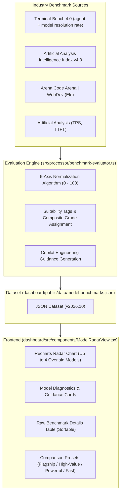
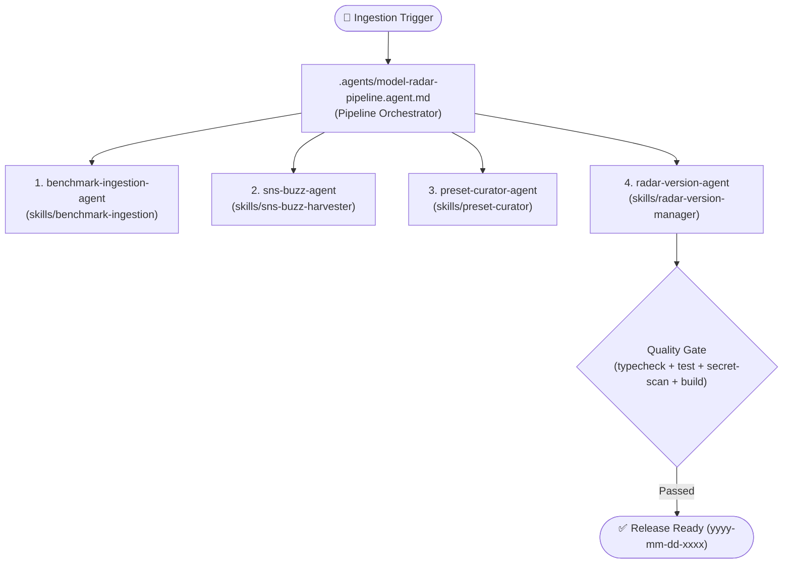

[English](10_ai_model_benchmark_radar_spec.md) | [日本語](10_ai_model_benchmark_radar_spec.ja.md)

---

# SDD-10: AI Model Benchmark Radar Specification

- **Document ID**: SPEC-COPILOT-010
- **Status**: Approved / Active
- **Target Version**: 2026.10-LTS
- **Date**: 2026-09-12
- **Updated**: 2026-10-13 (benchmark sources replaced, Issue #321)

---

## 1. Overview & Objectives

Defines the **AI Model Benchmark Radar (AI Model Radar & Benchmark)** subsystem of the GitHub Copilot Analytics Dashboard. This subsystem visualizes the technical capabilities and characteristics of available AI models across a 6-axis radar chart, assisting teams in selecting optimal models for diverse engineering tasks.

In full compliance with official GitHub Copilot documentation, it comprehensively covers supported models (OpenAI, Anthropic, Google, Microsoft, xAI, Moonshot AI), detailing standard/1M **context windows** and **pricing per 1M tokens (Input / Output / Prompt Caching / Long Context)**. It also persistently provides reference citations to official documentation ([supported-models](https://docs.github.com/en/copilot/reference/ai-models/supported-models) and [models-and-pricing](https://docs.github.com/en/copilot/reference/copilot-billing/models-and-pricing)). The long-context price label uses the model's `long_context_threshold_k` (200K when unset).

By integrating current industry benchmarks (Terminal-Bench 4.0, Artificial Analysis Intelligence Index v4.3, Arena Code Arena | WebDev, Artificial Analysis speed measurements and official pricing), the engine normalizes scores on a 0–100 scale, assigning suitability tags, best-practice recommendations, and developer community observations (*with community sentiment disclaimer*).

---

## 2. Architecture & Layout

### 2.1 Dashboard Integration Modes
- **Analysis View (`AnalysisViewId`)**:
  - `model_radar`: **AI Model Benchmark Radar & Evaluation View**
- **Navigation**:
  - One-click switching via the top `ViewNavigation` bar.
  - Contextual jumps from model legends in `UserTrendViewer` and related widgets.

### 2.2 Data Flow


### 2.3 Knowledge Model Retention & 0% Share Rendering
- **Persistent Knowledge Retention**:
  Even when analyzed datasets (Auto-collected Data or Monthly CSV) contain zero requests for a given model, all knowledge-base models remain selectable and visible across model chips, presets, and comparison tables.
- **0% Share for Unused Models**:
  Models with zero internal request volume display an enterprise share of **`0%` (0 req)**, labeled with an "Exploratory / Evaluation Knowledge" badge to guide trial adoption.
- **Identifier Normalization (`normalizeModelId`)**:
  Normalizes label variations (e.g., `Claude 3.7 Sonnet`, `GPT-4o mini`, `o1 (Reasoning)`, `Gemini 2.0 Flash`) to standard knowledge IDs (`claude-3-7-sonnet`, `gpt-4o-mini`, `o1`, `gemini-2-0-flash`).
- **Tag/Scope Filter Reactivity (`Usage Share (%)` Recomputation)**:
  Whenever the Tag filter or scope (target month, organization, etc.) changes, each model's usage volume and usage share (%) are always recomputed strictly from the currently "active analysis target data" (an applied example of [SDD-01 FR-9](01_requirements_specification.md) / [SDD-15: Data-Centric Reactivity Design Specification](15_data_centric_reactivity_design_spec.md)).
  - **Auto-collected Data**: Since per-user, per-model request counts (`model_usage_totals`) are retained, the breakdown is recomputed exactly from the user set after the tag AND-filter is applied.
  - **Monthly Usage Report / Uploaded Data**: User records retain only a single `primary_model` per user (no per-model breakdown per user), so when a tag filter is applied, `model_breakdown` is recomputed as an approximation that attributes each filtered user's full request count to their `primary_model`. When no tags are selected, the original precise breakdown computed at parse time is used unchanged.

### 2.4 Quick Navigation in Model Details Card
- **Top-Mounted 2-Tier Full-Width Layout**: Positioned at the very top of the card widget with a dedicated 2-tier row layout: upper tier hosts the label and index counter (`1 / 4`), while the lower tier utilizes the full width of the widget for step navigation buttons (`<` / `>`) and the wide model selector dropdown. This prevents unwanted line wrapping and layout shifting when model names are long.
- **Step Navigation**: `<` and `>` buttons enable swift cycling between selected models (disabled when only 1 model is active).
- **Dropdown Jump**: Clicking the model title reveals a full-width dropdown menu with theme colors, tiers, grades, and an active index counter.

### 2.5 Standard Comparison Presets (`PRESETS`)
Provides instant, pre-configured model comparisons across diverse tiers and scenarios. Recommended presets combine uncompromising quality standards with cost-performance variations, incorporating the new frontier `Claude Opus 5.5` alongside established models. For OpenAI models, standard comparisons feature stable GPT-5 family equivalents (GPT-5.5 / GPT-5.4 / GPT-5 mini), while the high-velocity, ultra-low-cost `GPT-5.6 Luna` is retained in high-value and lightweight presets.

#### Use-Case Recommended Presets
- **🔍 Recommended for Code Review (`recommended-code-review`)**:
  - **Rationale**: Strict quality gate for PR diff analysis and bug prevention, maintaining `Claude Opus 5.5` / `Claude Opus 5` while adding high-precision code models `GPT-6 Sol` and `GPT-5.6 Terra`.
  - **Selected Models (6 Models)**:
    1. **Next-Gen Frontier (Latest Deep Review)**: `Claude Opus 5.5` (In: $4.0, Out: $20.0 / TB4 64.85)
    2. **High-End (Deep Review Standard)**: `Claude Opus 5` (In: $5.0, Out: $25.0 / TB4 53.94)
    3. **Powerful Sol (High Reasoning Rapid Review)**: `GPT-6 Sol` (In: $2.0, Out: $10.0 / TB4 49.39)
    4. **Balanced (Production Standard)**: `Claude Sonnet 5` (In: $2.0, Out: $10.0 / TB4 12.42)
    5. **Versatile Terra (Robust Diff Analysis)**: `GPT-5.6 Terra` (In: $2.0, Out: $12.0 / TB4 21.52)
    6. **High-Value (Cost-Effective Review)**: `Gemini 3.8 Flash` (In: $0.75, Out: $3.75 / TB4 19.09)
- **📂 Recommended for Codebase Analysis (`recommended-codebase-analysis`)**:
  - **Rationale**: Strict quality gate for 1M context repository-wide understanding, adding premier 1M flagship `GPT-6 Astra` alongside `Claude Opus 5.5` and `Claude Opus 5`.
  - **Selected Models (5 Models)**:
    1. **Premier Flagship (1M Full-Repo Ingestion)**: `GPT-6 Astra` (In: $10.0, Out: $50.0 / 1M ctx, TB4 58.18)
    2. **Next-Gen Frontier (1M Full-Repo Ingestion)**: `Claude Opus 5.5` (In: $4.0, Out: $20.0 / 1M ctx, TB4 64.85)
    3. **High-End (1M Deep Ingestion)**: `Claude Opus 5` (In: $5.0, Out: $25.0 / 1M ctx, TB4 53.94)
    4. **Balanced (1M Standard Refactor)**: `Claude Sonnet 5` (In: $2.0, Out: $10.0 / 1M ctx, TB4 12.42)
    5. **High-Value (1M High-Volume Low-Cost)**: `Gemini 3.8 Flash` (In: $0.75, Out: $3.75 / 1M ctx, TB4 19.09)
- **🏛️ Recommended for Architecture & Design (`recommended-architecture`)**:
  - **Rationale**: Extreme reasoning and architecture design capabilities, featuring both `Claude Opus 5.5` and `Claude Opus 5`.
  - **Selected Models (5 Models)**:
    1. **Premier Flagship (Extreme Frontier Reasoning)**: `GPT-6 Astra` (In: $10.0, Out: $50.0 / AA 53, TB4 58.18)
    2. **Next-Gen Frontier (Steerability & Deep Design)**: `Claude Opus 5.5` (In: $4.0, Out: $20.0 / AA 58, TB4 64.85)
    3. **High-End (Proven Architecture & Macro Reasoning)**: `Claude Opus 5` (In: $5.0, Out: $25.0 / AA 51, TB4 53.94)
    4. **Balanced (Modular Architecture)**: `Claude Sonnet 5` (In: $2.0, Out: $10.0 / AA 38, TB4 12.42)
    5. **High-Value (Fast Brainstorming & Trade-offs)**: `Gemini 3.8 Flash` (In: $0.75, Out: $3.75 / AA 41, TB4 19.09)

#### Category & Vendor Presets
- **🌟 2026 Flagship Selection (`flagship-2026`)**: 2026 premier frontier flagships snapshot (Claude Opus 5.5 / Claude Opus 5 / GPT-6 Astra / Gemini 4 Argon / Kimi K3).
- **💡 Practical High-Value (`practical-high-value`)**: Claude Sonnet 5 / Gemini 3.8 Flash / GPT-6 Luna / GPT-5.6 Luna / Kimi K2.7 Code (*Adds GPT-6 Luna and retains GPT-5.6 Luna as high-value champions*).
- **⚡ Powerful Reasoning (`tier-powerful`)**: GPT-6 Astra / Claude Opus 5.5 / Claude Opus 5 / GPT-6 Sol / Gemini 4 Argon / Kimi K3 (*Adds GPT-6 Sol and Gemini 4 Argon; removes GPT-5.5*).
- **🛠️ Versatile Engineering (`tier-versatile`)**: Claude Sonnet 5 / GPT-5.6 Terra / Gemini 3.8 Flash / Grok 4.6 (*Adds GPT-5.6 Terra; removes GPT-5.4*).
- **🚀 Lightweight & Fast (`tier-lightweight`)**: GPT-6 Luna / GPT-5.6 Luna / Gemini 3.5 Flash / MAI-Code-1.1-Flash / GPT-5.4 mini (*Adds GPT-6 Luna and retains GPT-5.6 Luna as lightweight champions*).
- **🟠 Anthropic Suite (`vendor-anthropic`)**: Claude Sonnet 5 / Claude Opus 5.5 / Claude Opus 5 / Claude Fable 5.1 / Claude Haiku 4.5 (*Opus 5.5 added, Opus 5 retained*).
- **🟢 OpenAI Suite (`vendor-openai`)**: GPT-6 Astra / GPT-6 Sol / GPT-5.6 Sol (*Adds GPT-6 Sol and GPT-5.6 Sol, removes legacy GPT-5.5/5.4/mini*).
- **🔵 Google Gemini (`vendor-google`)**: Gemini 4 Argon / Gemini 3.8 Flash / Gemini 3.7 Flash / Gemini 3.6 Flash / Gemini 3.5 Flash

### 2.6 Model Comparison Chart: Radar Chart
The 6-axis comparison is drawn as a **radar chart** (recharts `RadarChart`, 0-100 scale, one polygon per selected model). The active (focused) model is a solid, thick, gently pulsing polygon in the foreground; the other selected models are dashed, low-opacity polygons. Clicking a polygon or a legend button sets `focusedModelId` and updates the detail card in lockstep. The dot plot introduced in P3-7 (`ModelDotPlot`) was reverted; raw values stay available in the benchmark table and the tooltip.

### 2.7 Left-Frame Model Selector & 3-Mode Display State Specification
- **Left-Frame Placement & Viewport Tracking (`sticky`)**:
  - The model selector is repositioned from inside the top overview card to a dedicated left-hand sidebar frame (`ModelSelectorSidebar`).
  - Anchored with `sticky top-20` and internal scrollability (`max-h-[calc(100vh-5.5rem)] overflow-y-auto`), allowing engineers to view and interact with all analysis widgets (radar chart, detail card, benchmark table, background stories) while dynamically toggling model comparisons without having to scroll back to the top.
- **3-Mode Display State Switching (`sidebarMode`)**:
  - **Expanded (`expanded`) [Default]**: Standard width (~320px) featuring full model names, model color swatches, Copilot badges, organization usage percentage, vendor/tier grouping toggles, and filters.
  - **Compact (`compact`)**: Narrow width (~210-220px) displaying model abbreviations preserving model family and version numbers without omission (e.g., `gpt-5.6-luna`, `gpt-6-astra`, `gpt-o1`, `gpt-o3-mini`, `opus-5`, `opus-4.8`, `sonnet-4.6`, `gemini-3.8-flash`) generated via `getModelShortName`, with rich tooltips on hover showing full model identity, grade, tier, and internal usage share. Header mode-switching buttons switch to icon-only format (`p-1`, omitting text labels) to eliminate vertical 1-character line wrapping artifacts in narrow widths; expanded mode enforces `whitespace-nowrap`.
  - **Collapsed (`collapsed`)**: Frame collapsed with horizontal real estate maximized for widgets. Simplified down to **only the AI model icon (Boxes) and expand toggle icon (PanelLeftOpen)** with no extra labels, plus an optional count badge.
- **State Persistence**:
  - The active mode (`expanded`, `compact`, or `collapsed`) is persisted across sessions in `localStorage` under `copilot_radar_sidebar_mode`.
- **Selection State & Batch Operations**:
  - **Default Initial Selection**: Defaults to the Top 3 models by actual organizational usage requests (`requests > 0`) in descending order via `getTopUsageModelIds`.
  - **Empty Data & Unselected Handling**: If no usage data exists or all model requests are 0 (or all models are deselected), initializes with empty selection (`selectedModelIds = []`). Both the 6-axis radar map and the detail diagnostics card switch to a synchronized empty state overlay with a button to select Copilot native models.
  - **Full Clear**: Clicking "クリア" completely empties the selection (`selectedModelIds = []`).
  - **Vendor / Tier Batch Selection**: "全選択 / 全解除" buttons under each Vendor and Tier heading toggle between selecting all and deselecting all models in that group cleanly (`onBatchSelectModels`).

---

## 3. Radar Chart 6-Axis Evaluation Metrics

| Metric Key | Display Label | Weight | Reference Benchmarks | Logic & Rationale |
| :--- | :--- | :--- | :--- | :--- |
| `coding_swe` | Coding & SWE | 25% | Terminal-Bench 4.0 (`terminal_bench_4`, 100%) | Autonomous completion of real terminal tasks by agent + model; percentile rank within the dataset. |
| `reasoning_logic` | Reasoning & Logic | 25% | Artificial Analysis Intelligence Index v4.3 (`aa_intelligence_index`, 100%) | Composite of reasoning, knowledge and coding evaluations run independently under the same conditions. |
| `arena_elo` | Community & Elo | 15% | Arena Code Arena \| WebDev Elo (`arena_webdev_elo`) | Blind user preference rating on generated web apps; percentile rank within the dataset. |
| `speed_latency` | Speed & Latency | 10% | Tokens / sec (TPS), TTFT | Output generation velocity; percentile rank within the dataset. |
| `cost_efficiency` | Cost Efficiency | 10% | Pricing per 1M tokens (In/Out) | Blended token rate (40% input, 60% output) ranked in reverse; lower cost yields higher scores. |
| `architecture_design` | Architecture & Context | 15% | Context Window (128K–2M) (45%), Terminal-Bench 4.0 (55%) | Repository-wide codebase comprehension and long multi-step task aptitude. |

### 3.1 Normalisation: Percentile Rank (P3-7 / B-15)
- **Why**: the former fixed anchors (SWE-bench 75 / AIME 90 / Elo 1460) were exceeded by current models, so 11 / 12 / 7 of 43 models were clamped at 99 and ten GA models tied on coding. Fixed anchors saturate whenever the field moves ahead of them.
- **Method (`percentile-rank-v1`)**: for each component the score is the percentile rank of the model's raw value among all models of the dataset, `(below + 0.5 * equal) / n` (ties share the mid rank), mapped onto 20-99 and kept to one decimal. Axis scores combine components with the weights of the table above (coding = Terminal-Bench 4.0, reasoning = AA Intelligence Index, Elo = Arena WebDev Elo, architecture = 0.45 context + 0.55 Terminal-Bench 4.0). The overall score is the weighted mean of the six axes (one decimal), so the top models are distinguishable.
- **Relative by design**: a score tells the position within the current dataset, not an absolute capability, so it moves when models are added. The **raw values are always shown next to the scores** (tooltip, benchmark table).
- `computeRadarScores(raw)` without a context (single model) keeps an anchor formula for backward compatibility. Since 2026-10 its anchors are Terminal-Bench 4.0 0% → 20 / 60% → 99, AA Intelligence Index 15 → 20 / 55 → 99 and Arena WebDev Elo 1250 → 20 / 1800 → 99 (architecture: context points × 0.45 + min(1, Terminal-Bench / 60) × 55). The qualitative evaluation (grade, tags, strengths / weaknesses) keeps its absolute thresholds and is judged on the anchor scores.
- Tests: `src/tests/benchmark-normalization.test.ts` (top models are not tied, rank boundaries, order independence).

### 3.1.1 Benchmark Sources and Raw Metrics (2026-10, Issue #321)
| Raw metric | Source | Value as of | Rule |
| :--- | :--- | :--- | :--- |
| `terminal_bench_4` (%) | Terminal-Bench 4.0, https://www.tbench.ai/leaderboard/terminal-bench/4.0 | 2026-10-12 | Read from the BenchLM snapshot of the official board (https://benchlm.ai/benchmarks/terminal-bench-4) because tbench.ai renders client-side |
| `aa_intelligence_index` (points) | Artificial Analysis Intelligence Index v4.3, https://artificialanalysis.ai/leaderboards/models (per model `https://artificialanalysis.ai/models/<slug>`) | 2026-10-13 | Values AA marks as "Estimated", or models with only a non-reasoning variant, count as not verified |
| `arena_webdev_elo` (Elo) | Arena (formerly LMArena / LMSYS) Code Arena \| WebDev, https://arena.ai/leaderboard/webdev | 2026-10-08 | - |
| `task_cost_usd` ($/task) | Terminal-Bench 4.0 Mean Rollout Cost & Artificial Analysis Task Cost | 2026-10-12 | Measured mean expenditure per attempted task trial (USD), accounting for harness and reasoning tokens. Supports bidirectional sorting with dynamic sort direction indicators (`ArrowUp`/`ArrowDown`) and robust undefined handling |
| `output_speed_tps`, Token prices, context | Artificial Analysis (speed), official GitHub Copilot pricing | unchanged | - |

- **Variants**: the highest listed reasoning / harness variant of each model is used.
- **Dropped sources**: SWE-bench Verified (OpenAI stopped reporting it on 2026-02-23 because of contamination and flawed tests, https://openai.com/index/why-we-no-longer-evaluate-swe-bench-verified/; the official board has no entries after 2026-02-26), LMSYS Chatbot Arena Coding (moved to Arena), AIME 2024 / GPQA Diamond / HumanEval+ (saturated; GPQA Diamond is 92.6-96.0% for every frontier model, MathArena marks final-answer competitions as deprecated). The dataset carries this note as `sources_note`, shown under the source list.
- **Verification record**: `.devs/changes/2026-10-13_RadarBenchmarkSourcesRefresh/verified-benchmarks-2026-10.json` (`null` = not verifiable); `src/tests/benchmark-sources-2026-10.test.ts` asserts that the records hold exactly these values.

### 3.1.2 Estimated Values (推測値) and Their Method
A raw metric without a verified value is an **estimate**. The record lists it in `estimated_metrics` (for example `["terminal_bench_4", "arena_webdev_elo"]`), and the UI shows a 「推測値」 marker next to that value (benchmark table and model detail card). Estimates are produced once by **quantile mapping**:
1. Take the model's percentile rank `(below + 0.5 * equal) / n` among all 45 models on the legacy metric that fed the same axis in the previous (2026-09) records: `swe_bench_verified` for `terminal_bench_4`, the 0.65 / 0.35 blend of the `aime_2024` and `gpqa_diamond` ranks for `aa_intelligence_index`, `arena_coding_elo` for `arena_webdev_elo`.
2. Map that rank onto the sorted verified values of the new metric by linear interpolation of their quantiles (`p × (k − 1)`).
3. Round: Terminal-Bench to one decimal, AA Intelligence Index and Arena Elo to integers.

The one-off script runs outside the repository; only the numbers are written to `benchmark-records.json` (the per-model ranks and results are kept in `.devs/changes/2026-10-13_RadarBenchmarkSourcesRefresh/estimated-values-2026-10.json`). As of 2026-10-13: Terminal-Bench 26 / 45, AA Intelligence Index 17 / 45 and Arena WebDev Elo 13 / 45 values are estimates.

- **Model-level flag**: `is_estimated` is derived as "every benchmark score metric (`BENCHMARK_SCORE_METRICS`: `terminal_bench_4`, `aa_intelligence_index`, `arena_webdev_elo`) is estimated"; such models also keep the 「推測値」 badge next to the model name. A record that only has the legacy `is_estimated: true` is treated as all three benchmark metrics estimated.
- `output_speed_tps` may also be listed (GPT-6.1 Sol and Claude Sonnet 5.5: speed not yet measured).
- Replace an estimate with the verified value and remove it from `estimated_metrics` once a source lists the model.

### 3.2 Model Catalog: Exact Alias Match (P3-7 / A-13)
`normalizeModelId` resolves a raw name through the model catalog (`src/processor/model-catalog.ts`: canonical ID + alias list). The match is an **exact match on the normalised alias** (lower case, letters and digits only); the only accepted variations are a trailing parenthetical (`Kimi K3 (Moonshot)`) and a trailing release date (`-20250219`). There is **no substring matching**: an unknown name returns `unknown:<raw>` and is kept as is, so an unknown new model (for example a `GPT-6 Nova`) is never counted as `gpt-6-astra`. Alias collisions throw. A test asserts that the catalog and the benchmark records list the same models and that every record id and name resolves to itself.

---

## 4. Suitability Tags & Model Roster (2026 LTS)

### 4.1 Suitability Tag Criteria
- **`Complex Refactoring`**: `terminal_bench_4 >= 40%` or `architecture_design >= 85`
- **`Algorithm Specialist`**: `reasoning_logic >= 85` or `aa_intelligence_index >= 45`
- **`Fast Inline Suggestion`**: `speed_latency >= 80` or `output_speed_tps >= 100 tps`
- **`Cost Saver`**: `cost_efficiency >= 80`
- **`Ultra-Long Context`**: `context_window_k >= 1000K (1M tokens)`
- **`High-Precision Coding`**: `coding_swe >= 85`
- **`Agent & Multi-Turn`**: `arena_elo >= 85`

### 4.2 GitHub Copilot Supported Models Roster (September 2026)

Comprehensive roster covering all 45 evaluated frontier models (36 Copilot-supported + 9 classic/external controls) compliant with official GitHub Copilot documentation ([Supported models](https://docs.github.com/en/copilot/reference/ai-models/supported-models) and [Models & pricing](https://docs.github.com/en/copilot/reference/copilot-billing/models-and-pricing)).

#### 1. OpenAI (12 Models)
| Model ID | Name | Tier | Status | Context | In / 1M | Out / 1M | Cache Read | Highlights |
| :--- | :--- | :--- | :--- | :--- | :--- | :--- | :--- | :--- |
| `gpt-6-astra` | GPT-6 Astra | Powerful | GA | 272K (1M) | $10.00 | $50.00 | $2.50 | 2026 premier deep-reasoning flagship |
| `gpt-6-1-sol` | GPT-6.1 Sol | Powerful | GA | 1.05M | $2.00 | $10.00 | $0.10 | Newest Sol; benchmark values verified 2026-10 (output speed still an estimate, `estimated_metrics`). Prices (including cache write $2.50 and long context > 272K: In $4.00 / Out $15.00) verified on 2026-10-08 against the official pricing table (`github/docs` `data/tables/copilot/models-and-pricing.yml`, commit `45a0f053ac67e8d1f56fc8f7ee38f0b2a58925c3` and `main`) |
| `gpt-6-sol` | GPT-6 Sol | Powerful | GA | 272K (1M) | $2.00 | $10.00 | $0.20 | New generation Powerful workhorse balancing capability and cost |
| `gpt-6-luna` | GPT-6 Luna | Lightweight | GA | 272K (1M ※Caution) | $0.10 | $0.50 | $0.01 | Ultra-fast inline completions (※Note poor long-context retention) |
| `gpt-5-6-sol` | GPT-5.6 Sol | Powerful | GA | 272K (1M) | $4.00 | $20.00 | $1.00 | GPT-5.6 workhorse for complex tasks |
| `gpt-5-6-terra` | GPT-5.6 Terra | Versatile | GA | 272K (1M) | $2.00 | $12.00 | $0.50 | High-speed versatile generalist |
| `gpt-5-6-luna` | GPT-5.6 Luna | Lightweight | GA | 200K (1M ※Caution) | $0.20 | $1.20 | $0.05 | Ultra-fast low-cost inline completions (※Note poor long-context retention) |
| `gpt-5-5` | GPT-5.5 | Powerful | GA | 272K (1M) | $5.00 | $30.00 | $1.25 | Frontier reasoning model |
| `gpt-5-4` | GPT-5.4 | Versatile | GA | 272K (1M) | $2.50 | $15.00 | $0.62 | Balanced engineering model |
| `gpt-5-4-mini` | GPT-5.4 mini | Lightweight | GA | 128K | $0.75 | $4.50 | $0.18 | High speed and value |
| `gpt-5-4-nano` | GPT-5.4 nano | Lightweight | GA | 128K | $0.20 | $1.25 | $0.05 | Ultra-lightweight inline assistant |
| `gpt-5-3-codex` | GPT-5.3-Codex | Powerful | LTS | 1M | $1.75 | $14.00 | $0.43 | Long-term support code specialist |
| `gpt-5-mini` | GPT-5 mini | Lightweight | GA | 128K | $0.25 | $2.00 | $0.06 | Established fast completion model |

> [!WARNING] Important Caveat on GPT-family Luna Models (GPT-6 Luna / GPT-5.6 Luna) Regarding Long Context
> Per official OpenAI comparative data (https://openai.com/ja-JP/index/gpt-5-6/ under "Long Context"), Luna models exhibit drastically inferior performance in search and information retention over long context windows compared to Sol and Terra. Even though 1M context is supported, massive repository ingestion and large cross-file refactoring should strictly use Sol/Terra, reserving Luna for rapid inline suggestions and local routine edits.

#### 2. Anthropic (11 Models)
| Model ID | Name | Tier | Status | Context | In / 1M | Out / 1M | Cache Read/Write | Highlights |
| :--- | :--- | :--- | :--- | :--- | :--- | :--- | :--- | :--- |
| `claude-sonnet-5-5` | Claude Sonnet 5.5 | Versatile | GA | 200K (1M) | $2.00 | $10.00 | $0.20 / $2.50 | Newest Sonnet; benchmark values verified 2026-10 (output speed still an estimate, `estimated_metrics`) |
| `claude-sonnet-5` | Claude Sonnet 5 | Powerful | GA | 200K (1M) | $2.00 | $10.00 | $0.20 / $2.50 | The standard flagship enterprise driver |
| `claude-opus-5-5` | Claude Opus 5.5 | Powerful | GA | 200K (1M) | $4.00 | $20.00 | $0.20 / $5.00 | Next-generation flagship reasoning & enhanced steerability |
| `claude-opus-5` | Claude Opus 5 | Powerful | GA | 200K (1M) | $5.00 | $25.00 | $0.50 / $6.25 | Deep architectural design & reasoning |
| `claude-fable-5-1` | Claude Fable 5.1 | Powerful | GA | 200K (1M) | $10.00 | $50.00 | $1.00 / $12.50 | EFS/ZDR enterprise security tier |
| `claude-fable-5` | Claude Fable 5 | Powerful | GA | 200K (1M) | $10.00 | $50.00 | $1.00 / $12.50 | Enterprise high-assurance reasoning |
| `claude-opus-4-8` | Claude Opus 4.8 | Powerful | GA | 200K | $5.00 | $25.00 | $0.50 / $6.25 | Deep analytical reasoning |
| `claude-opus-4-8-fast` | Claude Opus 4.8 Fast | Powerful | GA | 200K | $10.00 | $50.00 | $1.00 / $12.50 | Fast-mode Opus |
| `claude-opus-4-7` | Claude Opus 4.7 | Powerful | GA | 200K | $5.00 | $25.00 | $0.50 / $6.25 | Advanced reasoning |
| `claude-sonnet-4-6` | Claude Sonnet 4.6 | Versatile | GA | 200K | $3.00 | $15.00 | $0.30 / $3.75 | Versatile balanced coding |
| `claude-sonnet-4` | Claude Sonnet 4 | Versatile | GA | 200K | $3.00 | $15.00 | $0.30 / $3.75 | Reliable code completion |
| `claude-haiku-4-5` | Claude Haiku 4.5 | Lightweight | GA | 200K | $1.00 | $5.00 | $0.10 / $1.25 | Ultra-lightweight and responsive |

#### 3. Google (5 Models)
| Model ID | Name | Tier | Status | Context | In / 1M | Out / 1M | Highlights |
| :--- | :--- | :--- | :--- | :--- | :--- | :--- | :--- |
| `gemini-4-argon` | Gemini 4 Argon | Powerful | GA | 1M Tok | $2.00 | $10.00 | Frontier reasoning flagship, Terminal-Bench 57.27%, AA index 53 |
| `gemini-3-8-flash` | Gemini 3.8 Flash | Versatile | GA | 1M Tok | $0.75 | $3.75 | Latest Flash (promotional rate) / 1M tokens |
| `gemini-3-7-flash` | Gemini 3.7 Flash | Versatile | GA | 1M Tok | $0.75 | $3.75 | CoT reasoning & high-velocity coding |
| `gemini-3-6-flash` | Gemini 3.6 Flash | Versatile | GA | 1M Tok | $0.75 | $3.75 | 1M long-context generalist |
| `gemini-3-5-flash` | Gemini 3.5 Flash | Versatile | GA | 1M Tok | $1.50 | $9.00 | Proven Flash workhorse |

#### 4. Microsoft / xAI / Moonshot AI (6 Models)
| Model ID | Name | Provider | Tier | Status | Context | In / Out / 1M | Highlights |
| :--- | :--- | :--- | :--- | :--- | :--- | :--- | :--- |
| `mai-code-1-1-flash` | MAI-Code-1.1-Flash | Microsoft | Lightweight | GA | 128K | $0.20 / $1.20 | Microsoft ultra-fast code specialist |
| `grok-4-7` | Grok 4.7 | xAI | Versatile | GA | 200K (1M) | $2.00 / $6.00 | Reasoning CoT support, latest flagship Grok |
| `grok-4-6` | Grok 4.6 | xAI | Versatile | GA | 200K (1M) | $2.00 / $6.00 | High-accuracy practical coding |
| `grok-4-5` | Grok 4.5 | xAI | Versatile | GA | 200K | $2.00 / $6.00 | Versatile code completion |
| `kimi-k3` | Kimi K3 | Moonshot AI | Powerful | GA | 1M | $3.00 / $15.00 | 1M long-context reasoning |
| `kimi-k2-7-code` | Kimi K2.7 Code | Moonshot AI | Versatile | GA | 256K | $0.95 / $4.00 | 256K code specialist, high value |

#### 5. Classic & External Comparison Reference Models
Claude 3.7 Sonnet, Claude 3.5 Sonnet, GPT-4o, GPT-4o mini, o1, o3-mini, Gemini 2.0 Flash, Gemini 2.5 Pro, DeepSeek R1.

### 4.3 Official Citations
- 📘 **Supported AI Models in Copilot**: `https://docs.github.com/en/copilot/reference/ai-models/supported-models`
- 💳 **Copilot Models & Pricing**: `https://docs.github.com/en/copilot/reference/copilot-billing/models-and-pricing`

---

## 5. Benchmark Source Explanations & Community Observations

### 5.1 Source Descriptions
1. **Terminal-Bench 4.0 Leaderboard** (`terminal-bench-4`): real terminal tasks (build, dependencies, servers, data processing) completed by agent + model; measures autonomous agent execution. Caveat: scores depend on the agent harness.
2. **Artificial Analysis Intelligence Index v4.3** (`aa-intelligence-index`): composite of reasoning, knowledge and coding evaluations run by a third party under the same conditions. Caveat: the composition changes between index versions; AA marks some values as estimates.
3. **Arena Code Arena | WebDev** (`arena-webdev`): blind head-to-head votes on generated web apps (Elo). Caveat: low vote counts / Preliminary entries move; front-end centred.
4. **Artificial Analysis** (`artificial-analysis`): measured tokens-per-second (TPS), time-to-first-token (TTFT), and true blended pricing.

Each source carries `target_problem`, `performance_view` and `community_rumor` (always labelled `※ SNSの噂`; only publicly known caveats, no fabricated facts).

### 5.2 Community Observations Disclaimer
All community observations, tips, and quirks featured in model detail cards must prominently display a disclaimer badge: `* Community Sentiment & Developer Rumor`.

---

## 6. Individual Page Versioning Specification (`yyyy-mm-dd-0001`)

The AI Model Radar dataset and UI display feature individual page version tracking with calendar dates and incremental sequence numbers for the same day.

### 6.1 Format Standard
$$\text{Version} = \text{yyyy-mm-dd-xxxx}$$
- `yyyy-mm-dd`: Calendar date of generation (e.g., `2026-09-13`).
- `xxxx`: 4-digit zero-padded incremental sequence (`0001`, `0002`, `0003`...).
- **The version is managed by content hash (P3-7 / B-15)**: the dataset carries `content_hash` (first 16 hex chars of the sha256 of the benchmark records, axis definitions and normalisation method). `npm run benchmark:update` (also run by `pretest` / `prebuild`) keeps `version` and `last_updated` when the hash equals the existing file, and advances the sequence (`+1` on the same date, `0001` on a new date) **only when the content changed**. Running tests or builds no longer bumps the version. A legacy file without `content_hash` is bumped once.

### 6.1.1 Externalised Benchmark Data
The benchmark values are JSON data, not code: `scripts/benchmark-data/benchmark-records.json` (loaded by `loadBenchmarkRecords` in `scripts/update-benchmarks.ts`). Updating a model's numbers means editing that file; the script derives scores, evaluation, hash and version. The output `dashboard/public/data/model-benchmarks.json` stays generated (not committed).

### 6.1.2 Dual Sync (AGENTS.md rule 8)
When a model or benchmark changes, update together: `supported_models.md` (reference tables), `scripts/benchmark-data/benchmark-records.json` (+ `scripts/update-benchmarks.ts`), `src/processor/model-catalog.ts` (aliases) and the presets in `dashboard/src/components/radar/radar-constants.ts` (the UI model registry; `dashboard/src/data/models.ts` named in older rule text does not exist). `src/tests/benchmark-normalization.test.ts` fails when the catalog and the records diverge. This change adds, removes and renames no model, so `supported_models.md` is unchanged.

### 6.2 UI Presentation
- Displayed prominently beside the page title as `v2026-09-13-0001`.
- Tooltip hover provides clear context: "個別バージョン (日付・連番管理): {version}".

---

## 7. Update Pipeline Architecture (Agents & Skills Separation)

The update lifecycle is structured into a primary orchestrator agent and specialized sub-task agents/skills:



### 7.1 Agents & Skills Division
1. **Pipeline Orchestrator (`.agents/model-radar-pipeline.agent.md`)**:
   - Master conductor orchestrating the end-to-end update lifecycle.
2. **Benchmark Ingestion (`.agents/benchmark-ingestion.agent.md` / `skills/benchmark-ingestion`)**:
   - Updates official pricing, context window sizes, and benchmark results (Terminal-Bench 4.0, Artificial Analysis Intelligence Index, Arena WebDev, Artificial Analysis speed), and records unverified values in `estimated_metrics`.
3. **SNS Buzz Harvester (`.agents/sns-buzz.agent.md` / `skills/sns-buzz-harvester`)**:
   - Collects and distills authentic developer sentiment with explicit disclaimer notes.
4. **Preset Curator (`.agents/preset-curator.agent.md` / `skills/preset-curator`)**:
   - Filters candidate models against uncompromising quality gates and extracts 3-tier cost variations.
5. **Version Manager (`.agents/radar-version.agent.md` / `skills/radar-version-manager`)**:
   - Manages `yyyy-mm-dd-0001` incremental versioning and executes four-layer quality gate checks.

---

## 8. CLI Commands & Verification

- **Update Benchmarks & Increment Version**:
  ```bash
  npm run benchmark:update
  ```
- **Full Quality Gate**:
  ```bash
  npm run typecheck && npm test && npm run secret-scan && npm run build
  ```

> Raw metrics listed in a record's `estimated_metrics` have no verified source and are estimates (method: §3.1.2). The radar view shows a "推測値" marker next to each such value, and a model-level "推測値" badge when every benchmark metric is estimated. Replace the value and remove it from `estimated_metrics` once verified.
